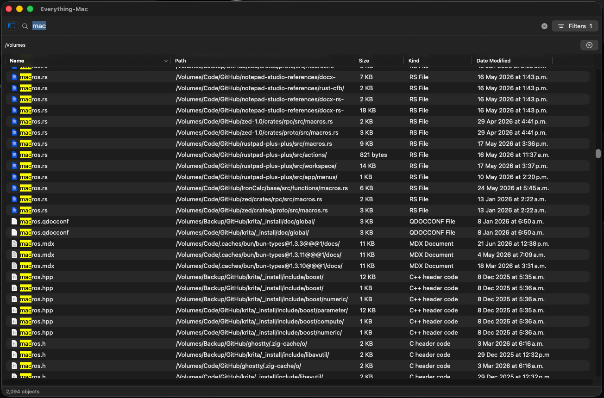

# EverythingMac

Search files and folders across your disks as you type. Fuzzy matching finds abbreviated names and tolerates a single letter typo in longer terms, with the best matches first. It's a macOS clone of [Everything](https://www.voidtools.com/), the search tool I lived in back on Windows.



**[Download the latest release](https://github.com/alesloa/everything-mac/releases/latest)** (macOS 14+), or [build it from source](#build-and-run).

> The folder is called `everything-rust` for historical reasons. There's no Rust in it. The whole app is Swift (SwiftUI and AppKit).
>
> This build isn't notarized by Apple, so on first open macOS will block it. Either run `xattr -dr com.apple.quarantine /Applications/EverythingMac.app`, or right-click the app and choose Open. See the [release notes](https://github.com/alesloa/everything-mac/releases/latest) for details.

## Why I built it

I switched to Mac from Windows, and the one tool I missed right away was Everything by voidtools. Hit a shortcut, type a few letters, and it lists every matching file and folder on the whole disk before you finish typing. It doesn't make you wait while it builds an index, and it doesn't reshuffle the results to show you what it thinks you meant.

Spotlight is supposed to cover this. It doesn't, at least not for me. The part that broke it was folder search: I'd look for a folder I knew was there and Spotlight wouldn't list all the ones that matched. It buries results and second-guesses what I actually typed. I'm a programmer. Finding a file by name is the most basic thing a computer does, and I don't want to fight it to do that.

So I wrote my own. It reads every filename on the machine into memory and searches that as you type. Open it, type, it's there. Want to open the file? Right-click and pick whatever app you want.

## What it does

- Fuzzy filename search enabled by default, with relevance ranking and an exact substring-search switch in the search bar. Quotes, wildcards, and Match Whole Word retain exact matching semantics.
- Searches local volumes and selected network shares, updating on each keystroke.
- Indexes the whole disk, files and folders, and keeps the index current through FSEvents.
- Standard results table with Name, Path, Size, Kind, and Date Modified. Click a header to sort.
- Shows the real file-type icon and a readable kind for each row.
- Right-click menu: Open, Open With (lists every app associated with the file, plus a "Choose Application…" option to open it with anything), Reveal in Finder, Copy Path, Copy Name, Move to Trash.
- Handles millions of files with parallel search, shared filename scoring, and reuse of prior candidates as you keep typing.
- First-launch onboarding waits for Full Disk Access before scanning, with an option to continue without it.
- Opt-in network-volume indexing in Settings > Volumes. Selected shares are scanned in the background, retain cached results while offline, and reconnect at launch and after sleep using credentials already saved in the keychain.
- Searches immutable snapshots on separate workers. Directory reconciliation, full rebuilds, network-tree merges, and cache saves keep the last published files searchable; new changes appear after publication. Superseded queries are cancelled.

### Fuzzy search

Type `fnlrpt` to find a name such as `FinalReport.pdf`, or `repotr` to find
`report.pdf`. Plain terms use subsequence matching; ASCII terms of at least five
characters can tolerate one wrong, extra, missing, or swapped letter at a word
prefix. The first letter must agree and digits are never corrected. Unicode
terms support subsequence matching. Multiple terms are combined with AND.

Use `"report"` for a literal substring, `rep*.pdf` for an anchored wildcard,
or turn off **Fuzzy** for the previous substring behavior. **Match Whole Word**
uses exact bounded terms. Select **View > Sort By > Relevance** for best matches
first, or a table column for ordinary sorting. Fuzzy and relevance are the new
defaults on upgrade; subsequent choices persist.

The matcher adapts the MIT-licensed scoring used by
[fsearch](https://github.com/noahdunnagan/fsearch), as integrated by
[FinderSearch](https://github.com/zeusinsight/FinderSearch). EverythingMac stays
entirely Swift and has no Rust helper dependency. See
[third-party notices](THIRD_PARTY_NOTICES.md).

To verify the non-blocking search path against the actual app indexing actor:

```bash
swift test -c release
./scripts/test-search-isolation.sh
```

The regressions in [`StartupSafetyTests.swift`](Tests/IndexCoreTests/StartupSafetyTests.swift)
and [`TableSafety.swift`](Tests/AppIntegrationTests/TableSafety.swift) exercise watcher
replacement/deallocation, corrupt cache counts, concurrent mount reads, and cached
file-size rendering. Run them with Address Sanitizer using:

```bash
./scripts/test-startup-safety.sh
```

The storage path in [`FileStore.swift`](Sources/IndexCore/FileStore.swift) and
[`IndexActor.swift`](App/Sources/IndexActor.swift) shares an immutable,
memory-mapped base between searches and the indexing writer. New records and
deletions use a small overlay, avoiding copies of the complete base during live
updates. Background compaction folds that overlay into a new mapping while
existing searches retain their original snapshot and record IDs.

[`UniqueNameIndex.swift`](Sources/IndexCore/UniqueNameIndex.swift) prepares the
filename dictionary in the background. Searches keep using the parallel scan
until it is ready, then reuse the base dictionary across live updates. The
derived dictionary and any snapshots still in use require additional memory.

## Requirements

- macOS 14 (Sonoma) or newer
- Xcode 16 or newer (Swift 6)
- [XcodeGen](https://github.com/yonaskolb/XcodeGen): `brew install xcodegen`

## Build and run

```bash
git clone https://github.com/alesloa/everything-mac.git
cd everything-mac
./scripts/build-dev.sh
```

The script generates the Xcode project from `App/project.yml`, builds a Release binary, and copies the app into `/Applications`. Build Release, not Debug. The search loop runs about 100x slower without optimization.

### Signing it as yourself

`App/project.yml` has my Apple Development identity hardcoded so Full Disk Access doesn't get revoked every time I rebuild on my own machine. To build it on yours, do one of these:

- Open `App/EverythingMac.xcodeproj` in Xcode, select the EverythingMac target, go to Signing & Capabilities, turn on "Automatically manage signing," and pick your team.
- Or edit `CODE_SIGN_IDENTITY` and `DEVELOPMENT_TEAM` in `App/project.yml` to your own values and re-run `./scripts/build-dev.sh`.

### Full Disk Access

The app can only index everything if you give it Full Disk Access:

System Settings > Privacy & Security > Full Disk Access > turn on EverythingMac.

The first launch scans the whole disk and writes the index to a cache, so it takes a few minutes depending on how many files you have. After that it starts instantly and picks up file changes as they happen.

### Network volumes

In Settings > Volumes, choose **Add Network Volume…**, select a mounted share or a folder on it, then click **Apply & Re-index**. The whole share is indexed separately from local drives. Automatic reconnection requires credentials already saved by Finder.

Network shares refresh when they reconnect or when you rebuild the index. Changes made while a share stays mounted do not appear live. Cached results can still be searched when a share is offline; opening a result requires the share to be reachable.

## Using it

Launch it and start typing. Matches show up right away. Click a column header to sort. Double-click a row to open it, or right-click for Open With, Reveal in Finder, Copy Path, Move to Trash, and the rest.

## How it works

- [`FileStore.swift`](Sources/IndexCore/FileStore.swift) keeps UTF-8 names and metadata in columns: a mapped base plus appended records and sparse deletion flags. [`IndexCache.swift`](Sources/IndexCore/IndexCache.swift) streams those columns to an atomically replaced binary cache and still reads the previous cache format.
- [`UniqueNameIndex.swift`](Sources/IndexCore/UniqueNameIndex.swift) groups byte-identical filenames and uses character bitmaps to reject groups of 64 names. The matcher scores each surviving name once, then expands it back to live records with their own paths and metadata.
- [`SearchIndex.swift`](Sources/IndexCore/SearchIndex.swift) reuses the complete previous match set when [`QueryNarrowing.swift`](Sources/IndexCore/QueryNarrowing.swift) proves the new query can only narrow it. It rescans when editing or changing options could add matches, and always recomputes scores and sorting.
- [`IndexActor.swift`](App/Sources/IndexActor.swift) applies FSEvents and publishes coherent snapshots. Searches, filename preparation, cache writes, and compaction run separately from the filesystem writer.

## License

[MIT](LICENSE)
